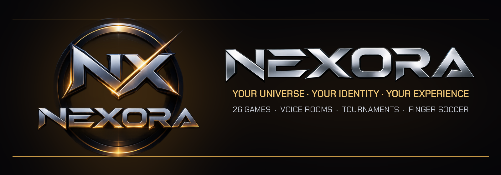
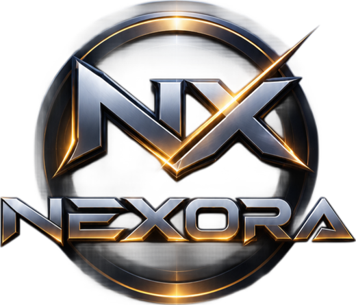

<p align="center">
  
</p>

<p align="center"></p>

<h1 align="center">NEXORA · ANIX PRO</h1>

<p align="center">
  <b>YOUR UNIVERSE. YOUR IDENTITY. YOUR EXPERIENCE.</b><br/>
  A cosmic gaming + social universe for Android: <b>26 games</b> online and vs. bots, <b>voice rooms</b> where friends talk and then play together,
  chat & calls, posts & stories, ranked ladders, tournaments — and ORACLE, a robot buddy with a (very) big personality.
</p>

<p align="center">
  <a href="https://github.com/Ashimashi74/nexora-universe/releases/latest"></a>
  <a href="https://github.com/Ashimashi74/nexora-universe/releases/latest"></a>
</p>
<p align="center">
  <a href="https://github.com/Ashimashi74/nexora-universe/actions/workflows/android.yml"></a>
  
  
  
  
  
</p>

<p align="center">
  <a href="#-download">Download</a> ·
  <a href="#-whats-inside">Features</a> ·
  <a href="#-rooms--talk-first-then-play">Rooms</a> ·
  <a href="#-finger-soccer--club-national-luxury">Finger Soccer</a> ·
  <a href="#-accounts">Accounts</a> ·
  <a href="#-tech">Tech</a> ·
  <a href="#-فارسی">فارسی</a>
</p>

---

## 📥 Download

**➡️ [Latest release — ANIX-universal.apk](https://github.com/Ashimashi74/nexora-universe/releases/latest)**

| File | For |
|---|---|
| `ANIX-universal.apk` | every Android phone (7.0+) |
| `ANIX-arm64-v8a.apk` | smaller download for most modern phones |

1. Open the [Releases page](https://github.com/Ashimashi74/nexora-universe/releases/latest) on your phone and download the APK.
2. Allow *Install unknown apps* for your browser or file manager when Android asks.
3. Install and open. Every new build is signed with the same key, so it **updates in place** — and the app tells you when a new version is out.

Every push to `main` is analysed, tested and built by CI; release builds are tagged `anix-v1.0.<build>` and marked **Latest**.

## ✨ What's inside

| | |
|---|---|
| 🎙️ **Rooms** | Voice stage + text chat + members. Unlimited speakers and listeners. The room manager picks a game, ticks the players, and everyone comes back to the room after the match. |
| 🎮 **26 games** | 9 classics, 7 multiplayer arcade games and 10 solo arcade games — offline vs. smart bots or online against real people, with reconnect & resync. |
| ⚡ **Quick match** | One tap to find an opponent: fair first-come pairing, no ghost seats, safe re-queue and reconnect. |
| 🏆 **Ranked & tournaments** | Per-game ELO ladders and global XP ranks, trophies, brackets up to 64 players with check-in, auto rounds and server-side prizes. |
| 👤 **Accounts** | Username + password (email optional), stay signed in, profile photo from your gallery, follow / unfollow with follower counts. |
| 💬 **Social** | 1:1 chats, groups and channels, voice & video calls, posts, 24 h stories, likes, comments. |
| 🤖 **ORACLE** | A cheeky robot buddy reacting to your real wins and losses — famous for its «جاااااان!». |
| 🔊 **Sound** | Music, in-game sounds and UI effects with separate switches and volume sliders. |
| 🌐 **Bilingual** | Full Persian (RTL) and English UI. |

## 🎙️ Rooms — talk first, then play

Rooms are built around conversation:

- **Voice stage** (LiveKit): managers and speakers talk, listeners listen; speaking rings light up live. Mute or promote anyone from the member list.
- **Chat** with a scrolling history, realtime delivery and the input pinned to the bottom; **members** shown with small round avatars — tap anyone to see their card and follow them.
- **Games tab**: the manager picks any online game and ticks who plays. Capacity is the manager's choice, bounded by what each game's rules actually allow — up to **12** for Mafia, **8** for Spy, **6** (two equal sides) for team games like Finger Soccer, **4** for the group games, **2** for the duels.
- **Pre-game line-up**: each picked player chooses a team and formation; the manager picks the pitch and the ball. Then the match starts for everyone at once, and when it ends **everyone is back in the room**.
- No caps on the audience: speakers and listeners are unlimited.

## ⚽ Finger Soccer — Club, National, Luxury

The flagship game: flick discs, bend shots, score.

- **122 teams in seven categories** — **Clubs** (47), **Nations** (19), **NX** (12), **Cars** (24), **Sport** (12), **Elite** (6) and **Legends** (2), every crest a clean **round disc**. Each team carries real **power** and **accuracy** stats.
- **🛡️ Your own team** *(new)* — buy the custom-team slot (1000 💎), upload a photo, it is cropped into a round crest and joins the shared **Custom Teams** list with every stat at **10**. You play it free forever; anyone else unlocks it for **250 💎**. Ownership and prices are enforced on the server.
- **🖤 Black-gold lobby** *(new)* — one luxury pre-match screen for online and pass-and-play: shared 30 s pick timer, opponent status, locked teams bought in place.
- **📐 Fair pitches** *(new)* — every pitch scaled to one standard, so discs, ball and goals are the same size everywhere; heavier discs and ball for smoother, weightier motion.
- **✨ Colour trails & rematch** *(new)* — each disc leaves a team-coloured trail; after an online match, ask for a **rematch** and play again in one tap.
- **22 balls**, 11 pitches, 9 formations; **1v1, 2v2, 3v3** online with turns rotating between teammates.
- **🏆 Tournaments** — up to 64 players, check-in, auto rounds, match length shown up front, prizes paid by the server.
- **🔊 Clean voice** *(new)* — game sound ducks under LiveKit voice instead of drowning it.

## 🎮 All games

| | Game | Online | Highlights |
|---|---|---|---|
| ⚽ | **Finger Soccer** | 2–6 | 122 teams + custom teams, 3v3 rotation, trails, rematch |
| 🎯 | **Carrom** | 2 | Queen + cover rule, fouls, deterministic replay |
| 🎱 | **Billiards** | 2 | Groups, ball-in-hand, cue skins |
| 🎲 | **Backgammon (تخته‌نرد)** | 2 | Bar, bearing off, gammons & backgammons |
| 🟡 | **Ludo** | 2–4 | Safe stars, captures, extra turn on 6 |
| 🐍 | **Snakes & Ladders** | 2–4 | Exact 100 to win |
| 🃏 | **NX Cards** (UNO-style) | 2–4 | Skip / reverse / +2 / wild, the **NX!** call |
| ❓ | **Quiz** | 2 | Timed questions, speed bonus, Persian banks |
| 🕵️ | **Mafia** | 6–12 | Godfather, doctor, detective, sniper; narrator mode; smart bots |
| 🏎️ | **Kart Racing** | 2–4 | Arcade racing |
| 🏃 | **Obstacle Race** | 2–4 | Party run |
| 💣 | **Bomb Arena** | 2–4 | Last one standing |
| 🎱 | **Pool 8** | 2 | Quick 8-ball |
| ⛳ | **Mini Golf** | 2–4 | Trick holes |
| 🏀 | **Basketball Battle** | 2–4 | Shoot-out |
| 🕶️ | **Spy Mafia** | 4–8 | Find the spy before they find the location |

The ten **solo arcade** games are single-player (no online seats) but share the arcade's medals, daily challenge and
server-validated global score boards:

| | Game | Controls | Highlights |
|---|---|---|---|
| 🏃 | **Endless Runner** | arrows | Three lanes; hop the barriers as the road speeds up |
| 🔺 | **Geo Dash** | tap | Tap to jump, hold to fly; spikes and flying blocks |
| 🚗 | **Traffic Racer** | arrows / swipe | Swap lanes and weave through traffic |
| 🍉 | **Fruit Ninja** | drag | Drag across the fruit; a bomb ends the run |
| 🔪 | **Knife Hit** | tap | Throw into the spinning log; it speeds up every 5 knives |
| 🌀 | **Helix Jump** | drag | Spin the tower, fall through the gaps, avoid the red rings |
| 🫧 | **Bubble Shooter** | drag | Match three or more to pop; clear the whole wall |
| 🧱 | **Stack Tower** | tap | Perfect drops build a combo; a miss trims the tower |
| 🔲 | **Tetris Rush** | arrows | Clear lines against an accelerating fall |
| 🔢 | **NX 2048** | arrows | Slide to merge equal tiles; reach 2048 |

Player counts are the game's real mechanics, mirrored by the server (`nx_game_bounds`) and re-checked there on every
capacity change, pick and start — a modified client cannot widen them.

## 👤 Accounts

- **Sign up** with a **username and password**; email is optional (only for recovery and never shown to anyone).
- **Log in** with your **username or email** + password. No codes, no waiting for emails.
- You **stay signed in** until you log out; after logging out the app remembers your last username, and password managers can save and fill your login.
- Usernames are looked up server-side by the `nx-login` Edge Function, so no one's email ever reaches another phone.
- **Profile photo** from your gallery (stored in your own folder, protected by storage policies) and **follow / unfollow** with live follower and following counts — private profiles get a follow request instead.

## 🧰 Tech

| Layer | What |
|---|---|
| App | **Flutter 3.50** (Dart), Riverpod, go_router, CustomPainter/Ticker game loops, audioplayers |
| Backend | **Supabase** — Auth, Postgres with RLS on every table and SECURITY DEFINER RPCs, Realtime, Storage, pg_cron, Vault, Edge Functions (Deno) |
| Games backend | a second Supabase project for rooms, matches, matchmaking, ratings and tournaments, accepting the main project's tokens |
| Voice | **LiveKit** — short-lived tokens from the `nx-call-token` Edge Function (calls and room stages) |
| CI/CD | GitHub Actions: analyze → tests → signed per-ABI + universal APKs → GitHub Release (`[release]` in the commit message) |

Game state, matchmaking, ratings and the economy are server-authoritative inside Postgres; there are no other servers.

<details>
<summary><b>Build from source</b></summary>

```bash
git clone https://github.com/Ashimashi74/nexora-universe.git
cd nexora-universe
flutter create --platforms=android --org com.nexora --project-name nexora .   # generates android/ (CI does the same)
flutter pub get
flutter analyze && flutter test
flutter build apk --release \
  --dart-define=SUPABASE_URL=https://<project>.supabase.co \
  --dart-define=SUPABASE_ANON_KEY=<anon key> \
  --dart-define=SOCIAL_SUPABASE_URL=https://<social-project>.supabase.co \
  --dart-define=SOCIAL_SUPABASE_ANON_KEY=<social anon key> \
  --dart-define=GAMES_SUPABASE_URL=https://<games-project>.supabase.co \
  --dart-define=GAMES_SUPABASE_ANON_KEY=<games anon key> \
  --dart-define=LIVEKIT_URL=wss://<livekit-host>
```

Without the `--dart-define`s the app runs fully offline (bots, local profile). SQL lives in [`supabase/migrations`](supabase/migrations) (accounts & social) and [`supabase/games/migrations`](supabase/games/migrations) (rooms & games); Edge Functions in [`supabase/functions`](supabase/functions).

```
lib/
  app/        shell, router, overlays        core/     backend, online, profile, settings, audio, UI kit
  games/      one folder per game            worlds/   hub, rooms, arcade, social, orbit, nova, settings, ORACLE
  features/   tournaments
supabase/     migrations · games/migrations · functions (nx-login, nx-call-token, nx-oracle)
test/         unit + widget tests (games, rooms, auth rules, assets, ORACLE, tournaments)
```
</details>

---

<div dir="rtl">

## 🇮🇷 فارسی

<p align="center"><b>جهان تو. هویت تو. تجربه‌ی تو.</b></p>

**NEXORA** یک جهان کیهانی بازی و شبکه‌ی اجتماعی برای اندروید است: **۲۶ بازی** آنلاین و با ربات، **اتاق‌های صوتی** که دوستان اول در آن گپ می‌زنند و بعد با هم بازی می‌کنند، چت و تماس، پست و استوری، رده‌بندی و تورنمنت — و «اوراکل»، ربات شیطون و بامزه‌ای که همه‌جا همراهت است.

### 📥 دانلود

**➡️ [آخرین نسخه — فایل ANIX-universal.apk](https://github.com/Ashimashi74/nexora-universe/releases/latest)**

۱. صفحه‌ی [Releases](https://github.com/Ashimashi74/nexora-universe/releases/latest) را روی گوشی باز کن و فایل APK را بگیر (`ANIX-arm64-v8a.apk` کم‌حجم‌تر است و روی بیشتر گوشی‌ها کار می‌کند).
۲. وقتی اندروید پرسید، اجازه‌ی «نصب برنامه‌های ناشناس» را بده.
۳. نصب کن. نسخه‌های بعدی روی همین نصب می‌شوند و اپ خودش خبر می‌دهد.

### ✨ امکانات

- **🎙️ اتاق‌ها:** صحنه‌ی صدا، گفتگوی متنی با پیام‌های زنده و کادر نوشتن پایین صفحه، فهرست اعضا با آواتار گرد. سخنران و شنونده **بی‌محدودیت**. مدیر اتاق بازی را انتخاب می‌کند، بازیکن‌ها را تیک می‌زند؛ هر بازیکن تیم و چیدمانش را می‌چیند و مدیر زمین و توپ را؛ بعد از بازی همه به اتاق برمی‌گردند. ظرفیت دست مدیر است و از قواعد واقعی هر بازی بیرون نمی‌زند: مافیا تا **۱۲ نفر**، جاسوس و مافیا تا **۸ نفر**، بازی‌های تیمی مثل فوتبال انگشتی تا **۶ نفر** (دو طرف برابر)، بازی‌های گروهی تا **۴ نفر** و دوئل‌ها **۲ نفر**.
- **⚽ فوتبال انگشتی (گل‌کوچیک):** ۱۲۲ تیم در هفت دسته‌ی **باشگاهی** (۴۷)، **ملی** (۱۹)، **نیکسورا** (۱۲)، **خودرو** (۲۴)، **ورزشی** (۱۲)، **ویژه** (۶) و **افسانه‌ای** (۲) با آمار قدرت و دقت شوت؛ لوگوی گرد برای همه‌ی تیم‌ها؛ **تیم اختصاصی خودت** (خرید با ۱۰۰۰ الماس، عکس خودت روی مهره، همه‌ی آمار ۱۰، برای بقیه ۲۵۰ الماس)؛ لابی مشکی‌طلایی؛ اندازه‌ی یکسان زمین و مهره در همه‌ی زمین‌ها؛ رد رنگی پشت مهره‌ها و **بازی مجدد** آنلاین؛ ۱۱ زمین، ۲۲ توپ و ۹ چیدمان؛ بازی **۱ به ۱، ۲ به ۲ و ۳ به ۳** با چرخش نوبت بین هم‌تیمی‌ها.
- **🎮 ۲۶ بازی:** ۹ بازی اصلی (فوتبال انگشتی، کارم، بیلیارد، تخته‌نرد، لودو، مار و پله، NX Cards، کوییز و مافیا)، ۷ بازی چندنفره‌ی آرکید (مسابقه‌ی کارت، مسابقه‌ی موانع، میدان بمب، بیلیارد ۸ توپ، مینی گلف، نبرد بسکتبال و جاسوس و مافیا) و ۱۰ بازی تک‌نفره‌ی آرکید (دونده‌ی بی‌پایان، جئو دش، مسابقه‌ی ترافیک، میوه‌بُر، چاقو زدن، پرش مارپیچ، حباب‌زن، برج بلوک، تتریس راش و ۲۰۴۸) — آفلاین با ربات یا آنلاین با آدم‌های واقعی.
- **⚡ بازی سریع:** پیدا کردن حریف با یک لمس؛ جفت‌شدن منصفانه، بدون صندلی‌های «روح»، اتصال دوباره‌ی امن.
- **🏆 رده‌بندی و تورنمنت:** امتیاز ELO برای هر بازی، رتبه‌ی کلی، جام‌ها، تورنمنت تا ۶۴ نفر با جایزه‌ی سمت سرور.
- **👤 حساب کاربری:** ثبت‌نام با **نام کاربری و رمز** (ایمیل اختیاری)، ورود با نام کاربری یا ایمیل — **بدون کد**؛ ورود ماندگار، به‌خاطر سپردن آخرین نام کاربری و پر شدن خودکار رمز. عکس پروفایل از گالری و **دنبال کردن / لغو دنبال** با شمار دنبال‌کننده‌ها.
- **💬 شبکه‌ی اجتماعی:** چت، گروه و کانال، تماس صوتی و تصویری، پست و استوری.
- **🔊 صدا:** موسیقی، صداهای بازی و جلوه‌های صوتی با کلید و ولوم جداگانه.

### 🧰 فناوری

Flutter برای اپ، Supabase (Postgres با RLS، Realtime، Storage و Edge Functions) برای بک‌اند، LiveKit برای صدا، و GitHub Actions برای ساخت و انتشار خودکار.

</div>

---

<p align="center"><sub>Made with 💜 for the گل‌کوچیک crew · جاااااااااان! · Original art only — no licensed logos; “NX Cards” is an UNO-style game, not affiliated with UNO.</sub></p>
