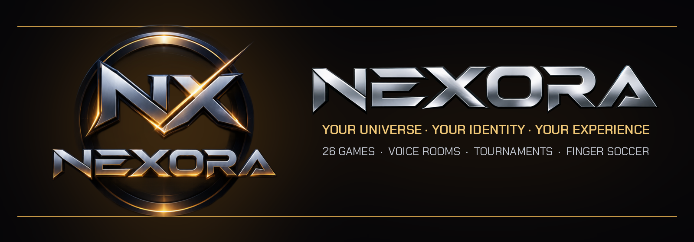

## 🆕 ANIX — گل کوچیک v7

- 🥅 **تیرک‌ها و داخل دروازه دقیقاً مثل دیواره‌ها برگشت می‌دهند**: توپ و مهره‌ها از تیرک، تور کناری و تور پشتی دروازه با همان قدرتِ برگشت دیواره‌های کنار زمین برمی‌گردند (۰٫۹، بدون اتلاف مماسی).
- 🔘 **دکمه‌ی «تغییر ترکیب» پایین آمد** و حالا درست کنار نوار بازی (پایین سمت چپ) است؛ کاملاً مثل قبل کار می‌کند.
- 🏟️ **شش زمین اضافه حذف شد**: Street Cage، Neon Cup، Gold Leather، Sockerbox، Royal Gold و Neon Grass. اگر یکی از این‌ها انتخاب شده بود، بازی خودکار روی زمین پیش‌فرض (ANIX Green) شروع می‌شود.
- ⚽ **دو توپ متحرک جدید**: **NX چرخان** (توپ اصلی و پیش‌فرض همه) و **NX ستاره**؛ دقیقاً با فریم‌ها و زمان‌بندی خود انیمیشن (۹۰ میلی‌ثانیه برای هر فریم)، چرخش از مرکز و بدون لرزش. از فروشگاه و انتخاب توپ قابل انتخاب‌اند.

## 🆕 ANIX — گل کوچیک v5

- ⏱️ **انتخاب تیم و ترکیب آنلاین با یک شمارش مشترک**: ۱۵ ثانیه انتخاب تیم، بعد ۱۵ ثانیه انتخاب ترکیب. هر کس زودتر انتخاب کند منتظر بقیه می‌ماند و همه با هم وارد بازی می‌شوند.
- 🐢 **کل صحنه آرام‌تر**: سرعت بازی ۸۵٪ (قبلاً ۹۵٪).
- 🌀 **چرخش مهره‌ها و توپ** حالا واضح دیده می‌شود (ضربه‌های مماسی مهره را می‌چرخاند، با یک نشانه‌ی کوچک روی لبه).
- 🥅 **دهانه‌ی دروازه ۳٫۵٪ باریک‌تر** (برخوردها دقیقاً مطابق تصویر دروازه).
- 🔁 **مدیر اتاق می‌تواند تیم ۱ و تیم ۲ را جابه‌جا کند** (قبل از شروع بازی، برای همه هماهنگ).
- 🏆 **نتیجه‌ی بازی‌های ۲×۲ و ۳×۳ درست شد**: همه‌ی بازیکن‌های یک تیم نتیجه و امتیاز تیم را می‌گیرند. اگر کسی وسط بازی تیمی خارج شود، باخت می‌گیرد و هم‌تیمی‌اش نوبت‌های او را بازی می‌کند؛ اگر یک تیم کامل خارج شود، تیم دیگر برنده است.
- ⚽ همراه با به‌روزرسانی‌های قبلی همین شاخه: مقدمه‌ی بازی (انتخاب تیم و ترکیب)، فیزیک مرجع، تغییر ترکیب وسط بازی و قطع موسیقی منو در طول مسابقه.

## 🆕 ANIX — فیزیک تازه‌ی گل کوچیک

- ⚽ **فیزیک گل کوچیک از نو تنظیم شد**: اصطکاک، پرتاب، منحنی قدرت و برخورد مهره‌ها با توپ و دیواره‌ها حالا مثل بازی واقعی رفتار می‌کنند؛ شوت‌ها طبیعی‌تر سُر می‌خورند و می‌ایستند.
- 💪 **قدرت و دقت تیم‌ها** همان مقادیر داخل بازی است و اثرش واقعی است: قدرت = سرعت شوت، دقت = خطای نشانه‌گیری کمتر.
- 🌐 بازی آنلاین روی سرور با همین فیزیک هماهنگ است؛ برای بازی آنلاین این نسخه را نصب کنید.

## 🆕 ANIX — به‌روزرسانی الماس، فروشگاه و گل کوچیک

- ⚽ **گل کوچیک**: اندازه‌ی مهره‌ها، توپ و دروازه با زمین متناسب شد (مهره ≈ یک‌ششم عرض زمین) و روی همه‌ی گوشی‌ها جا می‌شود. مهره‌ها دیگر زیادی سُر نمی‌خورند و زودتر می‌ایستند — قدرت و سرعت شوت دست نخورده.
- 🎙️ **میکروفون و بلندگو در اتاق‌ها**: داخل لابی بازی آنلاین، وسط مسابقه و اتاق‌های گفتگو، میکروفون (بی‌صدا/باصدا) و بلندگو (روشن/خاموش) با وضعیت قابل‌دیدن.
- 💎 **الماس**: ارز جدید، روی سرور؛ ۲۰۰ الماس هدیه‌ی خوش‌آمد + الماس روزانه؛ در هدر و فروشگاه.
- 🛒 **فروشگاه تیم‌ها**: پرسپولیس، استقلال و ایران رایگان؛ بقیه‌ی تیم‌ها ۱۵۰ تا ۵۰۰ الماس (تیم قوی‌تر، گران‌تر). خرید و کسر الماس روی سرور.
- 🛡️ **پنل مدیریت قوی‌تر**: اهدا/کسر سکه و الماس، تنظیم دقیق موجودی، قیمت‌گذاری فروشگاه، پروفایل و کوله‌پشتی کامل هر بازیکن، فهرست مسدودها، پیام و اعلان در اتاق‌ها، تغییر و پاک‌سازی اتاق‌ها.
- 🏆 **براکت تورنمنت** با طراحی جدید و بزرگ‌نمایی خودکار؛ تندیس‌ها و صحنه‌های جدید.

  

<h2 align="center">🤖 NEXORA Redesign — «ORACLE جاااااااااان!» Update</h2>

  

## ✨ مهم‌ترین‌ها

- 🤖 **اوراکل حالا شخصیت داره!** شیطون، بامزه، کمی تیکه‌انداز و گاهی غیرقابل‌پیش‌بینی — با امضای معروفش: **«جاااااااااان!»**
- 👥 **۳۹ بازیکن رو می‌شناسه** — اورجینال، صابر، لودر، کاکرو، پدرو، دنی، مهیار، اسکورپیون، شادو، علی‌گاد، آرش سیبیل و بقیه؛ با غلط تایپی و حروف لاتین هم (مثلاً `orginal` یا `mahyar ro mishnasi`).
- 😂 **خوشامد ورود تصادفی**: «جاااااااااان اورجینال رو بگیر! … اِه! تو که اورجینال نیستی!» — همیشه با اسم واقعی خودت و بدون ادعای دروغ.
- 🏆 **واکنش به برد و باخت واقعی** روی صفحه‌ی نتیجه — از «آفرین قهرمان! ترکوندی!» تا «اوراکل شاهد یک فاجعه تاریخی بود!»
- 🎓 **آموزش‌های خنده‌دار ولی دقیق**: «ضربات یخی فرم بزن!»، «بمیره دلی که بترسد! بزن بره!» — همراه توضیح واقعی کنترل‌ها؛ فقط برای تازه‌کارها، و از دکمه‌ی اوراکل داخل بازی دوباره قابل دیدن.
- 🧭 **تور راهنمای قدم‌به‌قدم**: اولین باری که هر بخش رو باز می‌کنی (خانه، داک، بازی‌ها، لابی هر بازی، اتاق‌ها، تورنمنت، فروشگاه، اجتماعی، چت، پروفایل، تنظیمات) اوراکل با نورافکن روی هر قسمت توضیحش می‌ده. «دیدن دوباره‌ی تور اوراکل» در تنظیمات.
- 💬 **جمله‌های خودجوش** با زمان‌بندی و بدون تکرار؛ وسط بازی مزاحم نمی‌شه.
- 🛠️ **همه‌چیز از پنل مدیر قابل‌ویرایشه**: بازیکن‌ها و نام‌های مستعار، جمله‌ها، خوشامدها، آموزش‌ها، متن تورها، احتمال‌ها و فاصله‌ها — بدون آپدیت اپ.
- 🧠 **هوش آنلاین اوراکل** (nx-oracle) حالا شخصیت و پروفایل‌های تأییدشده‌ی بازیکن‌ها رو می‌شناسه و چیزی از خودش نمی‌سازه.

## 📲 نصب

1. فایل **`NEXORA-redesign-universal.apk`** رو از پایین همین صفحه دانلود کن (برای اکثر گوشی‌ها `arm64-v8a` کوچیک‌تره).
2. اگه اندروید پرسید، «نصب از منابع ناشناس» رو برای مرورگر یا فایل‌منیجر فعال کن.
3. نصب کن و وارد شو. نسخه‌های قبلی redesign رو مستقیم آپدیت می‌کنه (همون کلید امضا).

## 🔄 آپدیت

به‌روزرسان داخل اپ این نسخه و نسخه‌های بعدی `redesign-*` رو خودش پیدا می‌کنه. اپ قبلی NEXORA (React Native) دست‌نخورده می‌مونه.

---

## ✨ Highlights (English)

- 🤖 **ORACLE has a personality** — cute, funny, playful, a little sarcastic, with the stretched signature **"جاااااااااان!"**.
- 👥 **Recognises 39 players** by name, with typos, ZWNJ/Arabic-letter variants and Latin spellings — personalised lines preserved verbatim.
- 😂 **Random login greetings** (the "is that Original?" mix-up joke) using your real display name, sometimes silent.
- 🏆 **Win/lose reactions** from real match results (offline and online).
- 🎓 **Funny but accurate tutorials** per game mechanic, shown to newcomers only, replayable from the in-game ORACLE sheet.
- 🧭 **First-run guided tour** with spotlight coach marks for every section; once per section per account (device + cloud profile); replay from Settings.
- 💬 **Spontaneous lines** with cooldowns and no repeats; never during key gameplay.
- 🛠️ **Admin-editable config** in Supabase (`nx_oracle_persona`, owner / `oracle` permission, audited).
- 🧠 **nx-oracle AI** gets the persona rules and verified player profiles as context.

### 📲 Install
Download **`NEXORA-redesign-universal.apk`** below (or `arm64-v8a` for most phones), allow installs from unknown sources, install. Updates previous redesign builds in place (same signing key).

### 🔄 Updates
The in-app updater picks up `redesign-*` releases (prerelease or not). This release is **not** marked "latest", so the React Native app's updater is unaffected.
